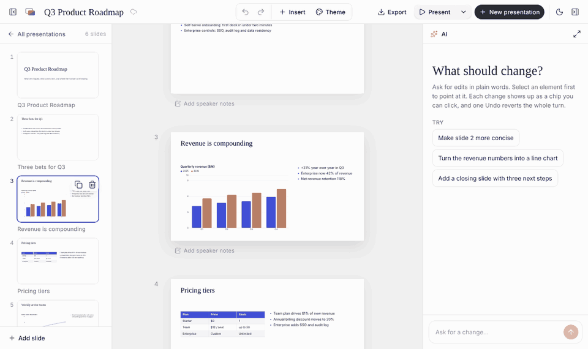

# AI Presentation Builder

Describe a deck, and the AI plans it, then fills it slide by slide through tool calls. You refine it in chat or directly on a free-form canvas: drag, resize and snap elements, drag them onto other slides, edit chart data and table cells, undo anything, then present or export to PowerPoint or PDF.

- **Live:** https://ai-presentation-builder-eosin.vercel.app/
- **Design records:** [docs/DECISIONS.md](docs/DECISIONS.md) (D1–D78, every decision and why) · [docs/TRADEOFFS.md](docs/TRADEOFFS.md) (what was deliberately not built) · [docs/ARCHITECTURE.md](docs/ARCHITECTURE.md) (diagrams) · [docs/THIRD_PARTY.md](docs/THIRD_PARTY.md) (licences)
- **Stack:** Vite + React 19 (JavaScript + JSDoc) · Vercel functions · AI SDK v7 with Sarvam `sarvam-105b` (Gemini and Groq as fallbacks) · Zustand + Immer patches · react-moveable · dnd-kit · Recharts · Tailwind v4 + shadcn/ui · pptxgenjs · React Router · IndexedDB
- **Why Vite + React (JavaScript), not Next.js:** a stack I can fully own and explain in two days; Zod gives runtime safety where it matters (tool inputs, ops, imported files); the model keys stay server-side in Vercel functions ([D18](docs/DECISIONS.md#d18-vite--react-javascript-on-vercel)).

All of the brief's seven review steps work, including step 5 (dragging a chart onto another slide's thumbnail, then asking the AI about it). Known gaps are listed honestly [below](#known-issues-and-gaps).

## Reviewer quick path

The brief's seven steps, mapped to clicks. Ctrl means Cmd on a Mac.

| #   | Step                                   | How                                                                                                                                                                                                                                                                                                                                                                                                     |
| --- | -------------------------------------- | ------------------------------------------------------------------------------------------------------------------------------------------------------------------------------------------------------------------------------------------------------------------------------------------------------------------------------------------------------------------------------------------------------- |
| 1   | Generate a 5–7 slide deck              | On the start screen, click the example **"Quarterly review with a chart and a table"** (or type your own), optionally pick a slide count, then **Generate** (or Ctrl+Enter). While the outline is planned the canvas shows the prompt, the stages and skeleton slides; then titled slides appear (the plan), and each fills in as its tool calls land; the chat shows progress and one chip per change. |
| 2   | Rewrite one slide; add a chart         | In the chat (right), e.g. _"Make slide 3 more concise"_, then _"Add a bar chart of quarterly revenue: Q1 12, Q2 18, Q3 25, Q4 31"_. Each reply lists the changes it made as chips (click one to jump to it); only those elements change, everything else keeps its id and position. **Undo this** reverts the whole turn.                                                                               |
| 3   | Reorder slides                         | Drag a thumbnail in the left filmstrip. A line shows where it will land.                                                                                                                                                                                                                                                                                                                                |
| 4   | Move and resize a text box and a chart | Drag either element on the canvas (alignment guides and snapping show), resize from the handles. Arrow keys nudge (Shift for bigger steps).                                                                                                                                                                                                                                                             |
| 5   | Move a chart to another slide          | Drag the chart onto another slide's **thumbnail** in the filmstrip (or onto the next slide in the column). A ring and "Move to slide N" show the target; hold **Alt** to copy instead; **Esc** cancels and puts it back. Then ask in the chat _"What is the chart about, and which slide is it on?"_: the AI's context is rebuilt from the deck on every turn, so it sees the chart on its new slide.   |
| 6   | Undo the last canvas move              | Ctrl+Z, or the undo arrow in the top bar. Every gesture is one undo step; an AI turn is one step too.                                                                                                                                                                                                                                                                                                   |
| 7   | Export and check charts and positions  | **Export → PowerPoint (.pptx)**: native, editable charts and tables at the same positions. **Export → PDF**: a print view (one slide per page) through the browser's print dialog. **Present** (or F5) shows the deck full screen.                                                                                                                                                                      |

If every model provider happens to be down, **Open the sample deck** on the start screen loads a ready-made deck, so steps 3–7 can still be tried.



_The chart from slide 3 dragged onto slide 4's thumbnail (sample deck). It lands in the free space below the table, shrunk to fit._

## Setup

Requirements: Node 24 (React Router 8 needs ≥ 22.22), npm 11. The [Vercel CLI](https://vercel.com/docs/cli) is optional.

```powershell
npm install
Copy-Item .env.example .env   # then fill in at least one model key
npm run dev                   # UI + /api functions on http://localhost:5173 (keys from .env)
```

| Script                            | What it does                                                                                                                                      |
| --------------------------------- | ------------------------------------------------------------------------------------------------------------------------------------------------- |
| `npm run dev`                     | Vite dev server with the `/api` functions served in-process (keys read from `.env`, server side only)                                             |
| `npm run dev:full`                | `vercel dev` (needs the Vercel CLI and a linked project): the exact production runtime                                                            |
| `npm run build`                   | Production build into `dist/`                                                                                                                     |
| `npm run lint`                    | ESLint, including the layer-import rules                                                                                                          |
| `npm run format` / `format:check` | Prettier                                                                                                                                          |
| `npm test`                        | Vitest: 214 unit and flow tests (ops, layout, schema, agent tools with mock models, API handlers, persistence, export mapping, photos, routing)   |
| `npm run llm:smoke`               | Checks each provider key: a forced `plan_deck` call and a tool loop (`-- sarvam`, `-- gemini` or `-- groq` for one; spends a few Sarvam credits)  |
| `npm run llm:probe`               | Runs the app's real AI path per provider with fallback off: plan a 4-slide deck, populate two slides, one edit; prints events, timings, op counts |

CI (GitHub Actions) runs `npm ci` → lint → format check → tests → build on every push. A pre-commit hook (husky + lint-staged) runs Prettier and ESLint on staged files.

### Environment variables

See [`.env.example`](.env.example). Keys are read only by the serverless functions and never reach the browser. One model key is enough; the app uses whichever providers have keys.

| Name                                         | Purpose                                                                                                                                                    |
| -------------------------------------------- | ---------------------------------------------------------------------------------------------------------------------------------------------------------- |
| `SARVAM_API_KEY`                             | Sarvam `sarvam-105b`, the primary model                                                                                                                    |
| `GOOGLE_GENERATIVE_AI_API_KEY`               | Gemini: chat fallback, and the image descriptions (`/api/describe`; each picture's small copy is sent to Gemini once)                                      |
| `GROQ_API_KEY`                               | Groq `openai/gpt-oss-120b`, second fallback                                                                                                                |
| `LLM_PROVIDER`, `LLM_FALLBACKS`              | Provider order (default `sarvam`, then `gemini,groq`)                                                                                                      |
| `SARVAM_MODEL`, `GEMINI_MODEL`, `GROQ_MODEL` | Optional model id overrides (defaults `sarvam-105b`, `gemini-3.8-flash`, `openai/gpt-oss-120b`)                                                            |
| `SARVAM_STREAM`, `SARVAM_REASONING`          | Optional: real token streaming for Sarvam (off by default, see [D37](docs/DECISIONS.md#d37-sarvam-runs-non-streamed-by-default)); reasoning effort (`low`) |
| `RATE_LIMIT_PER_MIN`                         | Optional per-IP request limit for `/api` (default 30)                                                                                                      |

Stock photos for AI-placed images need no key (Openverse, then Wikimedia Commons).

## Architecture overview

One rule holds everything together: **every change to a deck is an op**, and every op goes through one function, `dispatch(op)` → `applyOp(deck, op)`. A drag on the canvas, a keyboard shortcut, an edit in the data editor and an AI tool call all end there, so there is one source of truth, one undo history, and nothing can overwrite anything else ([D1](docs/DECISIONS.md#d1-one-op-language-one-dispatch), [D2](docs/DECISIONS.md#d2-the-client-store-is-canonical)).

**Data flow: schema → store → canvas / filmstrip / chat tools → export**

1. **Schema** (`src/lib/schema`, Zod). A deck has slides in an explicit order; each slide has a layout, background, speaker notes and elements in z-order. Every element has a stable id, a type (`text`, `image`, `chart`, `table`, `shape`), a bounding box in a fixed **1920 × 1080 artboard** (16:9), optional rotation, a lock flag, an optional group, and its own payload: paragraphs with bullets and levels, an image src with crop, a chart spec (kind, title, categories, series, legend and axis options), table rows. Colours are theme roles (`text`, `accent`, …), so a theme change restyles without touching content or positions.
2. **Ops** (`src/lib/ops`, pure JS shared by the browser and the server). `add_slide`, `update_slide`, `delete_slide`, `reorder_slides`, `duplicate_slide`, `change_layout`, `add_element`, `update_element`, `delete_element`, `move_element` (including to another slide, or a copy), `reorder_elements`, `update_deck`. Ops address everything by id and carry fully resolved boxes, so an op applies the same on the server's working copy and in the browser ([D24](docs/DECISIONS.md#d24-ops-are-id-anchored-and-fully-resolved)).
3. **Store** (`src/store`, vanilla Zustand). The canonical deck lives in the browser. `dispatch` applies ops with Immer's `produceWithPatches`, so each change records its own patches and inverse patches: that is the undo/redo history, at the cost of a diff rather than a deck copy. All ops from one AI turn join one history entry.
4. **Views.** One `SlideRenderer` draws a slide from the schema (DOM, not canvas) and is reused by the editable canvas (a continuous column of slides), the filmstrip thumbnails, Present mode, the print view and the start screen's previews. Components read the store through hooks only (lint-enforced).
5. **Chat tools.** The browser sends the deck (images replaced by references) to a Vercel function; the model calls tools; each tool resolves its input into ops, applies them to a throwaway copy on the server (so later calls in the same turn see the result), and streams them back as server-sent events. The browser dispatches them like any other op, so they animate into place on the canvas and land in the undo history.
6. **Export.** PowerPoint is built from the same deck by a pure mapping (`src/lib/export/pptx.js`, testable in Node) with native charts and tables; PDF is a print view of the same renderer; a deck file is the JSON itself.

**Where things live**

| Path                             | Contains                                                                                                                     |
| -------------------------------- | ---------------------------------------------------------------------------------------------------------------------------- |
| `src/lib/`                       | Pure JS shared with `/api`: schema, ops, layout and placement, themes, agent tools and prompts, PPTX mapping, photo helpers  |
| `src/store/`                     | The deck store: deck + history slice, UI slice (selection, panels, drag state), chat slice, composite actions                |
| `src/services/`                  | No React: AI client (SSE), persistence (IndexedDB), workspace (projects), PPTX export glue, stock photos, image descriptions |
| `src/hooks/`                     | React glue: store selectors, actions, keyboard, clipboard, navigation                                                        |
| `src/features/`                  | Canvas, filmstrip, chat, data editors, top bar, present and print, start screen                                              |
| `src/primitives/`                | Design-system components (shadcn/ui in JS, Radix), `MenuItem`, `IconButtonTip`                                               |
| `src/screens/`, `src/router.jsx` | Routes (React Router): `/` start screen, `/deck/:deckId` editor, `/deck/:deckId/present/:slide` Present                      |
| `api/`                           | Vercel functions: `plan`, `populate`, `agent`, `describe`; `api/_lib` for providers, the tool loop, SSE, request guard       |

Imports only go downwards (`features → hooks → services/store → lib`; `api → lib`), enforced by ESLint. More, with diagrams: [docs/ARCHITECTURE.md](docs/ARCHITECTURE.md).

## Drag-and-drop and cross-slide moves

**Libraries.** [react-moveable](https://github.com/daybrush/moveable) for dragging, resizing, alignment guides, snapping and moving several elements together; [dnd-kit](https://dndkit.com) (sortable) for reordering slides in the filmstrip. Moving onto another slide uses our own hit-testing, because neither library drops across separately scaled artboards ([D7](docs/DECISIONS.md#d7-drag-resize-and-snap-react-moveable-reorder-dnd-kit)).

**Coordinate space.** Every box is stored in artboard units (1920 × 1080). Each slide is drawn at that size and CSS-scaled to fit the column; thumbnails are the same renderer at a smaller scale. A screen distance divides by the slide's scale to become artboard units. 144 units = 1 inch, so PowerPoint export maps positions exactly.

**During a gesture** Moveable only changes the element's inline transform; nothing is written to the store. Guides snap to the slide's edges and centre and to other elements' edges and centres (8 px threshold, distances shown). While dragging, the pointer is hit-tested with `document.elementsFromPoint` for a filmstrip thumbnail (`[data-slide-drop]`) or another slide in the column (`[data-slide-frame]`); the target gets a ring and a "Move to slide N" / "Copy to slide N" badge. Dragging near the column's edge scrolls it, and the element keeps following the pointer.

**On drop**, exactly one dispatch (one undo step):

- **Same slide:** `move_element` with the new box (or `update_element` after a resize).
- **Another slide in the column:** the element's screen position is converted into that slide's artboard units, so it lands where it was released: `move_element { toSlideId, bbox }`.
- **A thumbnail:** there is no precise point, so it goes to the free spot nearest its old position that doesn't cover existing content, shrinking (keeping its proportions) to 75%, 50% and then 35% if needed. If the slide is full, it **makes room**: the element takes half of the area below the title, and the elements in its way are narrowed or shortened to end where it begins (text and tables shrink their text, charts redraw). The title and locked elements are never touched; only if nothing can give way does it land on top (`fitOnSlide`, [D63](docs/DECISIONS.md#d63-a-full-slide-makes-room-instead-of-being-covered)). The move and the trims are one undo step. The AI's `move_element` to another slide uses the same rules.
- **Alt held:** the same, with a new id: a copy, and the original stays.
- **Esc:** the inline styles are restored and nothing is written, so cancelling is exact.
- **Too big for the target:** the box is clamped into the artboard (never rejected, never off-slide).
- **Groups and multi-selections** move as one piece and keep their arrangement; on another slide the whole group is shifted inside the artboard together rather than each element clamped on its own ([D54](docs/DECISIONS.md#d54-groups-and-multi-selections-drag-to-other-slides)).

**Filmstrip reorder:** dnd-kit gives the new index; it is converted into "after slide X" (`reorder_slides { slideId, afterSlideId }`), since ops never address by index.

Because the move is an op in the shared store, the AI's next request includes the element on its new slide.

## AI agent

**Two-phase generation** ([D12](docs/DECISIONS.md#d12-two-phase-generation-orchestrated-by-the-client)). `/api/plan` forces one `plan_deck` call: a deck title and, per slide, a title, layout, intent, key points and planned visual (chart, table, image or none). The titled skeleton slides appear at once. The browser then calls `/api/populate` for each slide, two at a time; each fills one slide with tool calls (text, chart, table, image, speaker notes). A failed slide can be retried alone; Stop keeps whatever has landed.

**Edits are patches, never regeneration** ([D11](docs/DECISIONS.md#d11-granular-tools-no-regenerate-path)). `/api/agent` exposes granular tools and no "regenerate" tool:

- slides: `add_slide`, `update_slide`, `delete_slide`, `reorder_slides`, `duplicate_slide`, `change_layout`
- elements: `add_text`, `add_chart`, `add_table`, `add_image`, `add_shape`, `update_element`, `update_elements`, `delete_element`, `move_element` (to another slide, or copy), `resize_element`, `reorder_elements`
- charts: `update_chart_data`, `change_chart_type` (data kept)
- `get_slide` (full content when the summary is truncated), `finish_turn` (summary and follow-up suggestions as structured data)

**Context every turn** ([D13](docs/DECISIONS.md#d13-compact-fresh-context-every-turn)): a compact description rebuilt from the store: slide order with ids, every element's id, type, box and a short content summary, chart categories and series, the current slide and the selection (so "this" works), plus the last few chat turns. Manual edits are therefore always visible to the model, and no image bytes are sent with chat requests.

**Images.** `add_image` takes a short search query and alt text. The browser fills the placeholder with an openly licensed photo (Openverse, then Wikimedia Commons; CC0, public domain or CC BY only; credit kept on the element and written to the PPTX speaker notes), and keeps the placeholder if neither finds one ([D57](docs/DECISIONS.md#d57-stock-photos-from-openverse-with-wikimedia-commons-as-fallback)). Because the chat model reads text only, each picture (uploads included) is described once by Gemini through `/api/describe`, and that description is what the AI sees ([D58](docs/DECISIONS.md#d58-images-described-once-by-a-vision-model)).

**Guard rails.** Tool inputs are validated with Zod and every op is checked by `applyOp` on the server first; an invalid call returns an error to the model, which can correct itself, and nothing reaches the browser. Locked elements can't be moved, edited or deleted by the AI, and the AI can lock an element but never unlock one ([D77](docs/DECISIONS.md#d77-the-ai-can-lock-but-never-unlock)). AI-proposed boxes never overlap existing content ([D41](docs/DECISIONS.md#d41-content-spacing-lead-slots-trimmed-slots-auto-shrink)), content the app places itself never starts above a slide's title, and while generating the cover holds only its title and subtitle (other title or section slides that get content switch to a content layout) ([D60](docs/DECISIONS.md#d60-reading-order-title-first), [D64](docs/DECISIONS.md#d64-no-content-above-the-title-cover-slides-stay-covers)). Prompts are versioned (`PROMPT_VERSION`).

**Providers and Sarvam results.** The chain is Sarvam `sarvam-105b`, then Gemini, then Groq `gpt-oss-120b`, switching on rate limits, overload, errors, or a turn that ends without doing its job, and only while no op has been applied yet. What testing showed:

- Sarvam handles tool calling (a forced `plan_deck` in about 6 s in the first smoke test) and runs the full plan → populate → edit path in `npm run llm:probe`.
- Its **streamed** tool-call chunks fail the SDK's schema, so Sarvam runs non-streamed: each step is one request replayed as a stream. Ops and chips still arrive step by step, but text doesn't stream token by token ([D37](docs/DECISIONS.md#d37-sarvam-runs-non-streamed-by-default)).
- With a tool forced on every step it sometimes answered in prose, so only the first step forces a tool, and a prose answer is retried once ([D36](docs/DECISIONS.md#d36-tool-choice-per-step-local-api-in-vite-gemini-model)).
- A plan call once came back empty (13.6 s), so a run that ends without a plan, or a populate without any ops, is retried and then falls back ([D38](docs/DECISIONS.md#d38-a-run-must-finish-its-job-plan-retries-7-character-ids)).
- Reasoning tokens count against the output limit, so reasoning is set to `low` and output limits are explicit.

**Undo for AI changes.** All ops of one AI turn are one history entry; Ctrl+Z or **Undo this** on the chat message reverts the turn. Undo is disabled while a turn is still running.

## Design system

Light-first with a full dark mode, inspired by sarvam.ai's visual language without using its assets ([D17](docs/DECISIONS.md#d17-design-language), [D32](docs/DECISIONS.md#d32-design-system-implementation)).

- **Tokens** in `src/styles/index.css` (Tailwind v4 `@theme`): shadcn's semantic colours plus `panel`, `subtle`, `canvas`, `faint`; **indigo marks the user** (selection, focus) and **saffron marks the AI** (progress, the glow on elements it changed, its chips). The slides are the most colourful thing on screen.
- **Type:** Instrument Serif for display and slide titles, Geist for UI and slide text, Geist Mono for data; a fixed UI scale (`text-ui`, `text-label`, `text-display`).
- **Motion tokens** (`--motion-fast/base/move/emphasis`, easing tokens, a JS `motion()` helper): no raw durations anywhere, enforced by a test; reduced-motion respected ([D48](docs/DECISIONS.md#d48-motion-tokens-speaker-notes-slide-transitions-ai-change-animation)).
- **Components:** shadcn/ui (ported to JS) on Radix, one `MenuItem` row for every menu, Lucide icons at 1.5 px stroke.
- **Slide themes:** Paper, Sage and Midnight, with dark display variants Ink and Moss. Elements store colour roles, so switching theme keeps every position and word; chart palettes were checked for contrast and colour-vision deficiency.
- **Layouts:** title, section, content, two-column, comparison, chart-focus and blank, each with named slots that the AI fills; text that doesn't fit shrinks (never below the theme minimum) instead of overflowing.

## Also built

Present mode (F5, arrow keys, speaker notes with N, fade or push transitions, Esc or the last slide exits) · themes · up to 5 saved presentations in IndexedDB with autosave and a recent list · deck file export and import (.json) · URL routes with deep links and Back/Forward · insert menu (text, title, list, chart, table, image upload or URL, shapes) · chart and table data editor (double-click a chart; series colours from the theme palette or custom; paste cells from a spreadsheet or CSV) · copy, cut and paste elements (between slides and tabs) · group / ungroup (Ctrl+G) · lock · image crop and replace · box select · layer order (one step, or to front / back) · duplicate (Ctrl+D) · arrow-key nudge · AI changes glide into place with a brief highlight · speaker notes editor · toasts with Undo for deletions, and in-app confirmation dialogs (no browser pop-ups).

## Known issues and gaps

- **No automated end-to-end test of the reviewer script.** The plan ([D22](docs/DECISIONS.md#d22-testing-and-evaluation)) included a Playwright test of the seven steps, a golden-prompt eval of tool choice and a dev trace panel; none were built in the time. Instead, the seven steps are run by hand on the live URL, each change was checked with throwaway Playwright scripts against a local build, and the unit and flow tests run the agent's tools and API handlers with mock models.
- **Sarvam text doesn't stream token by token** (see above); progress shows as ops landing on the canvas.
- **"Undo this" only for the latest AI turn.** Once newer edits exist, Ctrl+Z steps back through them in order; undoing an older turn selectively isn't supported ([TRADEOFFS](docs/TRADEOFFS.md)).
- **Dropping onto a full slide** narrows or shortens the elements in the way, which may not be the arrangement you'd choose; one Ctrl+Z restores everything. If the element in the way is locked, the drop lands on top.
- **Reading order** is enforced in code only while generating; in later chat edits it relies on the prompt, because the user may ask for something above the title.
- **Stock photos** depend on Openverse and Wikimedia being reachable and finding a match; a long, specific query may still end as a placeholder. Each browser keeps a daily request budget below the services' limits. If a photo host refuses a cross-origin download, the photo shows on the canvas but is left out of the PowerPoint file (the export reports it).
- **Image descriptions** need the Gemini key, and send one small copy of each picture to Google once. Without the key, the AI only knows a picture by its alt text.
- **PowerPoint export:** fonts are named as Cambria and Arial (the web fonts aren't installed with Office; text is re-measured so it still fits); groups are exported as separate shapes; image crop is baked into the exported picture.
- **PDF** goes through the browser's print dialog (choose "Save as PDF"), not a server-generated file.
- **Text** is plain paragraphs with bullets and indent levels: no bold or italic inside a line, no links.
- **Rotation** is in the schema, drawn on the canvas and written to the PowerPoint file, but nothing in the app sets it yet: there is no rotate handle and no AI tool for it. A rotated element only arrives through an imported deck file. It can be selected, dragged and resized (its outline follows the rotation), but placement and overlap checks treat it as its unrotated box.
- **Storage is per browser** (IndexedDB, 5 most recent presentations); there is no account or sync, by design of the brief.
- **Rate limiting** on `/api` is in memory per serverless instance, so it is best-effort.
- **Desktop only.** Built and checked in Chromium-based browsers with mouse and keyboard; touch and small screens aren't supported.
- **Long chats:** the AI gets the last 8 chat messages plus a fresh description of the whole deck each turn; older messages are dropped, not summarised. The deck description is what keeps edits accurate, so this mostly loses earlier conversational context.
- **Not built from the plan:** Indic-language decks, a "use your own API key" setting, a tone option on the start screen (tone can be given in the prompt, or changed afterwards in chat).

## AI chat transcripts

Transcripts of the AI-assisted planning and build sessions are exported separately and submitted with this repository. The decision records in `docs/DECISIONS.md` were kept alongside them, so each change can be traced to the request that prompted it.

## Credits

- [Presenton](https://github.com/presenton/presenton) (Apache-2.0): studied for ideas only; no code copied. See [docs/TRADEOFFS.md](docs/TRADEOFFS.md#references).
- [sarvam.ai](https://www.sarvam.ai): visual inspiration for the design system; no brand assets or fonts used.
- Stock photos from [Openverse](https://openverse.org) and [Wikimedia Commons](https://commons.wikimedia.org) under their stated licences, credited per image. Fonts and libraries: [docs/THIRD_PARTY.md](docs/THIRD_PARTY.md).
