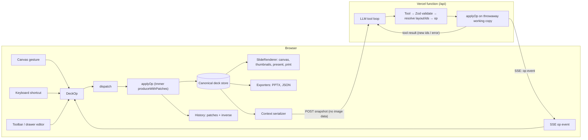
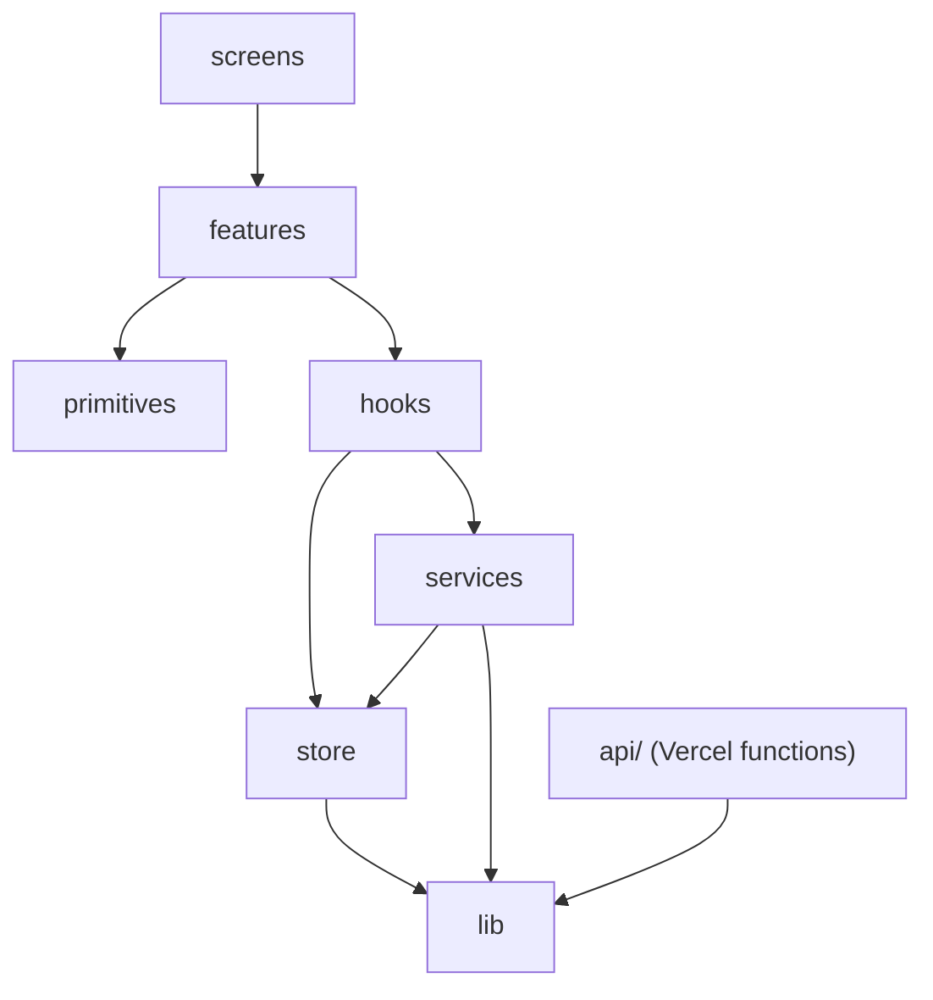
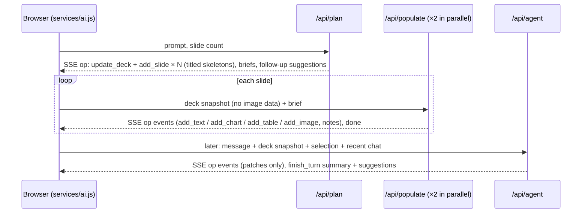
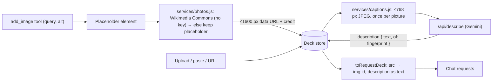

# Architecture

> How the app is put together. The why behind each part is in [DECISIONS.md](DECISIONS.md), what was built and fixed along the way in [BUILD_LOG.md](BUILD_LOG.md) (one numbering, D1–D80); options not taken are in [TRADEOFFS.md](TRADEOFFS.md).

## The one invariant

Every deck change is an **op**, and every op goes through `dispatch(op)` → `applyOp(deck, op)`. User gestures and AI tool calls converge there, so there is one mutation path, one history and one source of truth ([D1](DECISIONS.md#d1-one-op-language-one-dispatch), [D2](DECISIONS.md#d2-the-client-store-is-canonical)).



`applyOp` lives in `src/lib/ops` and is the same code in both boxes. Ops are id-anchored and carry resolved boxes and ids, so they land the same on the server's working copy and on the client store even if the user edited mid-stream ([D24](DECISIONS.md#d24-ops-are-id-anchored-and-fully-resolved)).

## Layers



| Layer            | Contains                                                                     | May import                              |
| ---------------- | ---------------------------------------------------------------------------- | --------------------------------------- |
| `src/lib`        | schema, ops, layout, theme, serializers, ids — pure JS                       | npm utilities only (enforced by ESLint) |
| `src/store`      | vanilla Zustand store and slices                                             | `lib`                                   |
| `src/services`   | agent client (SSE), generation orchestration, export, persistence — no React | `store`, `lib`                          |
| `src/hooks`      | React glue: selector hooks, actions, gestures                                | `services`, `store`, `lib`              |
| `src/primitives` | dumb UI blocks and shadcn components                                         | —                                       |
| `src/features`   | domain components (canvas, filmstrip, chat, drawer…)                         | `hooks`, `primitives`                   |
| `src/screens`    | route components (`StartRoute`, `DeckRoute`, `PresentRoute`) and screens     | `features`, `hooks`                     |
| `api/`           | `plan`, `populate`, `agent`, `describe` functions                            | `src/lib` only (enforced by ESLint)     |

## Coordinates

All geometry is in a fixed 1920×1080 artboard, CSS-scaled to the screen. 144 units = 1 inch, so 1920 units is exactly a 16:9 PowerPoint slide width ([D5](DECISIONS.md#d5-fixed-19201080-artboard)).

## Tool → op mapping

Tools live in `src/lib/agent/tools.js`. Each resolves its flat input into ops, applies them to the server's working copy and emits them ([D35](DECISIONS.md#d35-the-agent-as-built)).

| Tool                                                           | Ops emitted                                                                                       |
| -------------------------------------------------------------- | ------------------------------------------------------------------------------------------------- |
| `plan_deck` (generation only)                                  | `update_deck` (title) + one `add_slide` per planned slide (title element)                         |
| `add_slide`                                                    | `add_slide` with a title element; `afterSlideId` `"START"` = first                                |
| `update_slide`, `delete_slide`, `reorder_slides`               | same-named op                                                                                     |
| `duplicate_slide`                                              | `duplicate_slide` with a fresh `newSlideId` and `idMap`                                           |
| `change_layout`                                                | `change_layout` with `placements` from `reflowLayout` (slotted elements reflow, hand-placed stay) |
| `add_text`, `add_chart`, `add_table`, `add_image`, `add_shape` | `add_element` with a fresh id and a box from `placeElement`                                       |
| `update_element`, `update_elements`                            | `update_element` per element (flat fields mapped to the element's patch; may lock, never unlock)  |
| `delete_element`, `reorder_elements`                           | same-named op                                                                                     |
| `move_element`                                                 | `move_element` (box, or `toSlideId` + `fitOnSlide`; `copy` adds `newId`)                          |
| `resize_element`                                               | `update_element` with the new `bbox`                                                              |
| `update_chart_data`, `change_chart_type`                       | `update_element` on the chart                                                                     |
| `get_slide`, `finish_turn`                                     | none (read / end of turn)                                                                         |

## Turn lifecycle

1. The client builds the request from the store (`toRequestDeck`: no image data) and POSTs it; the response is SSE.
2. The server checks the body (size counted as it is read, then Zod), picks the first provider with a key and runs `streamText` with the tools. Events: `status` (provider, fallback), `text` (assistant text), `tool` (start/done/error), `op` (resolved ops for one tool), `error`, `done` (summary, suggestions, usage).
3. The client queues `op` events and dispatches them once per animation frame (source `ai`, the turn's id), so the whole turn is one undo entry. Each tool's ops become a chip on the chat message.
4. Stop aborts the fetch; the abort reaches the model call. Ops already applied stay. During generation, every slide that still holds only its title can be filled later with Continue.

## Drag-and-drop and cross-slide moves

```mermaid
sequenceDiagram
  participant U as Pointer
  participant M as react-moveable
  participant H as Hit-test (elementsFromPoint)
  participant S as Store (dispatch)
  U->>M: drag / resize
  M->>M: inline transform only (no store writes)
  M->>H: pointer position each move
  H-->>U: drop ring + "Move to slide N" badge (store: dropTarget)
  alt Esc
    M->>M: restore inline styles, write nothing
  else release on same slide
    M->>S: move_element { bbox }
  else release on another slide frame
    M->>S: move_element { toSlideId, bbox in that slide's units }
  else release on a thumbnail
    M->>S: move_element { toSlideId, fitOnSlide: free spot, shrink 75/50/35%, or make room } + trims
  end
  Note over S: one op = one undo step; Alt adds newId (copy); groups shift as one piece
```

- **Coordinates:** boxes are stored in artboard units; each slide frame is the artboard CSS-scaled by `scale`, so a screen delta ÷ `scale` = artboard units. A frame drop converts the element's screen rect into the target artboard's units.
- **Hit-testing:** `document.elementsFromPoint` at the pointer, first `[data-slide-drop]` (filmstrip thumbnail) or `[data-slide-frame]` (another slide in the column) that isn't the source slide. Drag state (`draggingSlideId`, `dropTarget`) lives in the store, never in `classList`, so re-renders can't wipe it.
- **Scrolling:** Moveable `scrollable` with `scrollOptions` whose `container` is a getter for the slide column ([D74](BUILD_LOG.md#d74-moveable-auto-scroll-settings-in-scrolloptions)); near the edge the column scrolls and a replayed pointer event keeps the element under a still cursor ([D34](BUILD_LOG.md#d34-dragging-across-a-scrolling-column-drop-ring-undo-reveal)).
- **Multi-selection:** one group drag; a click without movement inside an ungrouped multi-selection selects the element under the pointer ([D56](BUILD_LOG.md#d56-tidy-removed-click-inside-a-multi-selection-table-height)).
- **Filmstrip reorder:** dnd-kit sortable; the drop index becomes `reorder_slides { slideId, afterSlideId }`.

## Generation and edits



The provider chain (`api/_lib/providers.js`, `runTurn.js`) tries Sarvam, then Gemini, then Groq, and only falls back while no op has been emitted. A run must finish its job (`isComplete`: a plan arrived, or ops landed) or it counts as a failure ([D38](DECISIONS.md#d38-a-run-must-finish-its-job-plan-retries-7-character-ids)).

## Images



Photos and descriptions run in the browser, one at a time, with a per-browser budget for Wikimedia Commons ([D57](DECISIONS.md#d57-stock-photos-from-openverse-with-wikimedia-commons-as-fallback), [D79](DECISIONS.md#d79-stock-photos-from-wikimedia-commons-only), [D58](DECISIONS.md#d58-images-described-once-by-a-vision-model)). Descriptions are stored without an undo step (`dispatch(..., { record: false })`).

## Export

- **PowerPoint:** `lib/export/pptx.js` maps the deck to pptxgenjs calls (pure, tested in Node): 144 units = 1 in, native charts and tables, text and table cells re-measured in the browser with the export fonts (Cambria, Arial) so they fit their boxes ([D72](BUILD_LOG.md#d72-audit-fixes-and-series-colours)), images framed and cropped as on the canvas, stock-photo credits in the speaker notes. `services/pptxExport.js` loads pptxgenjs on demand and downloads the file ([D44](BUILD_LOG.md#d44-export-print-present-box-select-themes-deck-files)).
- **PDF:** a print view of the same `SlideRenderer`, one slide per page, scaled with CSS `zoom` (Chromium drops SVG charts inside scaled transforms when printing).
- **Deck file:** the deck JSON, validated with the same schema on import, including unique ids in every order and across slides.

## Persistence and routing

- **IndexedDB** through `services/kvStore.js` (idb-keyval in the browser, a Map in tests): up to 5 projects (deck + chat), autosaved after changes (an emptied project is saved too, so deleted content doesn't come back); the start screen lists them ([D39](BUILD_LOG.md#d39-persistence-and-the-startscreen-as-built), [D52](DECISIONS.md#d52-persistence-behind-a-four-method-store-tests-use-memory-not-fake-indexeddb)).
- **React Router** decides what is on screen: `/` (start), `/deck/:deckId` (editor; loads the project unless it's open), `/deck/:deckId/present/:slide` (Present, a child route). Workspace actions return deck ids and the hooks navigate; nothing writes `history` by hand ([D59](DECISIONS.md#d59-react-router-owns-navigation)).
