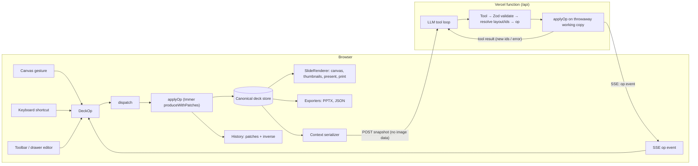
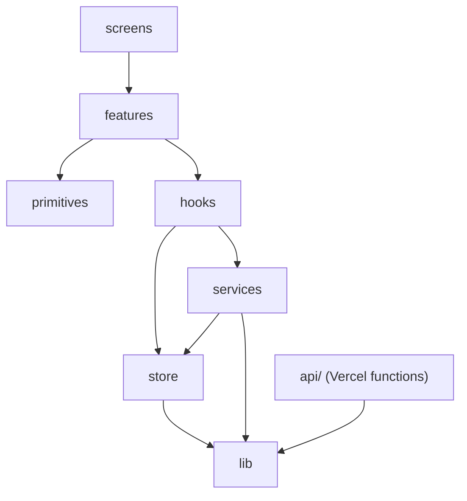

# Architecture

> First version (day 1). Diagrams for the agent flow and export are added as those parts land.

## The one invariant

Every deck change is an **op**, and every op goes through `dispatch(op)` → `applyOp(deck, op)`. User gestures and AI tool calls converge there, so there is one mutation path, one history and one source of truth ([D1](DECISIONS.md#d1-one-op-language-one-dispatch), [D2](DECISIONS.md#d2-the-client-store-is-canonical)).

`applyOp` lives in `src/lib/ops` and is the same code in both boxes. Ops are id-anchored and carry resolved boxes and ids, so they land the same on the server's working copy and on the client store even if the user edited mid-stream ([D24](DECISIONS.md#d24-ops-are-id-anchored-and-fully-resolved)).

## Layers

| Layer            | Contains                                                                     | May import                              |
| ---------------- | ---------------------------------------------------------------------------- | --------------------------------------- |
| `src/lib`        | schema, ops, layout, theme, serializers, ids — pure JS                       | npm utilities only (enforced by ESLint) |
| `src/store`      | vanilla Zustand store and slices                                             | `lib`                                   |
| `src/services`   | agent client (SSE), generation orchestration, export, persistence — no React | `store`, `lib`                          |
| `src/hooks`      | React glue: selector hooks, actions, gestures                                | `services`, `store`, `lib`              |
| `src/primitives` | dumb UI blocks and shadcn components                                         | —                                       |
| `src/features`   | domain components (canvas, filmstrip, chat, drawer…)                         | `hooks`, `primitives`                   |
| `src/screens`    | route-level assembly                                                         | `features`                              |
| `api/`           | `plan`, `populate`, `agent` functions                                        | `src/lib` only (enforced by ESLint)     |

## Coordinates

All geometry is in a fixed 1920×1080 artboard, CSS-scaled to the screen. 144 units = 1 inch, so 1920 units is exactly a 16:9 PowerPoint slide width ([D5](DECISIONS.md#d5-fixed-19201080-artboard)).

## Tool → op mapping

Tools live in `src/lib/agent/tools.js`. Each resolves its flat input into ops, applies them to the server's working copy and emits them ([D35](DECISIONS.md#d35-the-agent-as-built)).

| Tool                                                           | Ops emitted                                                                                       |
| -------------------------------------------------------------- | ------------------------------------------------------------------------------------------------- |
| `plan_deck` (generation only)                                  | `update_deck` (title) + one `add_slide` per planned slide (title element)                         |
| `add_slide`                                                    | `add_slide` with a title element; `afterSlideId` `"START"` = first                                |
| `update_slide`, `delete_slide`, `reorder_slides`               | same-named op                                                                                     |
| `duplicate_slide`                                              | `duplicate_slide` with a fresh `newSlideId` and `idMap`                                           |
| `change_layout`                                                | `change_layout` with `placements` from `reflowLayout` (slotted elements reflow, hand-placed stay) |
| `add_text`, `add_chart`, `add_table`, `add_image`, `add_shape` | `add_element` with a fresh id and a box from `placeElement`                                       |
| `update_element`, `update_elements`                            | `update_element` per element (flat fields mapped to the element's patch)                          |
| `delete_element`, `reorder_elements`                           | same-named op                                                                                     |
| `move_element`                                                 | `move_element` (box, or `toSlideId` + `findFreeSpot`; `copy` adds `newId`)                        |
| `resize_element`                                               | `update_element` with the new `bbox`                                                              |
| `update_chart_data`, `change_chart_type`                       | `update_element` on the chart                                                                     |
| `get_slide`, `finish_turn`                                     | none (read / end of turn)                                                                         |

## Turn lifecycle

1. The client builds the request from the store (`toRequestDeck`: no image data) and POSTs it; the response is SSE.
2. The server validates the body, picks the first provider with a key and runs `streamText` with the tools. Events: `status` (provider, fallback), `text` (assistant text), `tool` (start/done/error), `op` (resolved ops for one tool), `error`, `done` (summary, suggestions, usage).
3. The client queues `op` events and dispatches them once per animation frame (source `ai`, the turn's id), so the whole turn is one undo entry. Each tool's ops become a chip on the chat message.
4. Stop aborts the fetch; the abort reaches the model call. Ops already applied stay.

## Sections to come

- Drag-and-drop and cross-slide hit-testing
- Export pipeline
