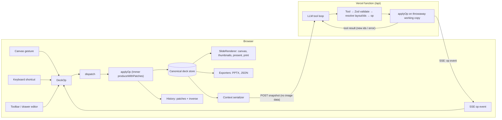
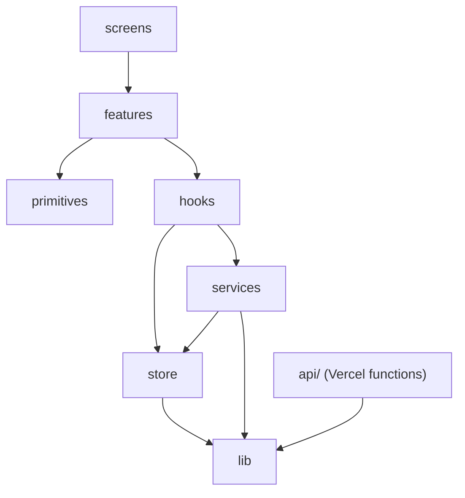

# Architecture

> First version (day 1). Diagrams for the agent flow and export are added as those parts land.

## The one invariant

Every deck change is an **op**, and every op goes through `dispatch(op)` → `applyOp(deck, op)`. User gestures and AI tool calls converge there, so there is one mutation path, one history and one source of truth ([D1](DECISIONS.md#d1-one-op-language-one-dispatch), [D2](DECISIONS.md#d2-the-client-store-is-canonical)).

`applyOp` lives in `src/lib/ops` and is the same code in both boxes. Ops are id-anchored and carry resolved boxes and ids, so they land the same on the server's working copy and on the client store even if the user edited mid-stream ([D24](DECISIONS.md#d24-ops-are-id-anchored-and-fully-resolved)).

## Layers

| Layer            | Contains                                                                     | May import                              |
| ---------------- | ---------------------------------------------------------------------------- | --------------------------------------- |
| `src/lib`        | schema, ops, layout, theme, serializers, ids — pure JS                       | npm utilities only (enforced by ESLint) |
| `src/store`      | vanilla Zustand store and slices                                             | `lib`                                   |
| `src/services`   | agent client (SSE), generation orchestration, export, persistence — no React | `store`, `lib`                          |
| `src/hooks`      | React glue: selector hooks, actions, gestures                                | `services`, `store`, `lib`              |
| `src/primitives` | dumb UI blocks and shadcn components                                         | —                                       |
| `src/features`   | domain components (canvas, filmstrip, chat, drawer…)                         | `hooks`, `primitives`                   |
| `src/screens`    | route-level assembly                                                         | `features`                              |
| `api/`           | `plan`, `populate`, `agent` functions                                        | `src/lib` only (enforced by ESLint)     |

## Coordinates

All geometry is in a fixed 1920×1080 artboard, CSS-scaled to the screen. 144 units = 1 inch, so 1920 units is exactly a 16:9 PowerPoint slide width ([D5](DECISIONS.md#d5-fixed-19201080-artboard)).

## Sections to come

- Tool → op mapping (see [D24](DECISIONS.md#d24-ops-are-id-anchored-and-fully-resolved) for now)
- Streaming protocol and turn lifecycle
- Drag-and-drop and cross-slide hit-testing
- Export pipeline
